# Les Items

## Pioches spéciales

### Pioche à Spawner

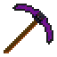{ .item-icon }
Cette pioche a une durabilité assez faible, mais permet de récupérer les spawners en les minant, pour pouvoir les replacer autre part.

<figure class="recette" markdown="span">
  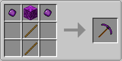
  <figcaption>Recette de la Pioche à Spawner</figcaption>
</figure>

### Pioche Explosive

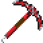{ .item-icon }
Cette pioche a une chance de faire exploser le bloc que vous venez de miner, ce qui peut permettre de découvrir des minerais cachés derrière les blocs alentour, ou simplement de miner plus vite. Le joueur qui utilise la pioche ne prendra pas de dégâts d'explosion lors de son utilisation.

<figure class="recette" markdown="span">
  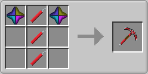
  <figcaption>Recette de la Pioche Explosive</figcaption>
</figure>

### Marteaux

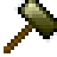{ .item-icon }
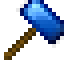{ .item-icon }
Les marteaux en Aventurium et en Electronium permettent de creuser dans une zone de 3x3. Attention, cette propriété ne s'applique que sur les blocs dont l'outil est la pioche. Ils possèdent sinon toutes les autres propriétés d'une pioche classique.

<figure class="recette" markdown="span">
  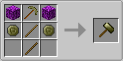
  <figcaption>Recette du Marteau en Aventurium</figcaption>
</figure>
<figure class="recette" markdown="span">
  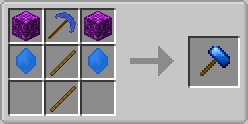
  <figcaption>Recette du Marteau en Electronium</figcaption>
</figure>

## Anneaux

Les anneaux ont des pouvoirs très puissants. Récupérables à travers les lucky-blocs, ils ne sont utilisables que toutes les 24 heures.

### Anneau de Téléportation

{ .item-icon }
Cet anneau permet de se téléporter aléatoirement dans le monde. Utile pour trouver un nouvel emplacement pour une base, ou pour rechercher un pillage.

### Anneau de Force

{ .item-icon }
Cet anneau donne un effet de force II pendant 5 minutes. La potion de force est désactivée, donc cet anneau peut certainement donner la victoire en PvP.

### Anneau d'Invisibilité

{ .item-icon }
Cet anneau donne un effet d'invisibilité pendant 2 minutes. La potion d'invisibilité est également désactivée, donc cet anneau peut permettre d'accomplir un pillage furtif sans être repéré.

### Anneau de Fortune

{ .item-icon }
Cet anneau augmente les items récupérés en minant les minerais et en tuant des mobs pendant 10 minutes. Il peut être combiné avec les enchantements fortune et butin (looting), ainsi qu'auto-fonte (auto-smelt) pour les minerais qui doivent être cuits.

## Outils spéciaux

### Aimant

{ .item-icon }
Une fois activé, l'aimant permet d'attirer à vous les objets au sol ainsi que les orbes d'expérience dans un rayon de 24 blocs.

<figure class="recette" markdown="span">
  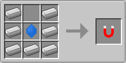
  <figcaption>Recette de l'Aimant</figcaption>
</figure>

### Houe en Galactium

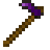{ .item-icon }
Elle fonctionne de la même façon qu'une houe normale, mais son action s'applique sur une zone de 3x3 blocs.

<figure class="recette" markdown="span">
  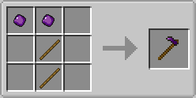
  <figcaption>Recette de la Houe en Galactium</figcaption>
</figure>

### Deltaplane

{ .item-icon }
Si vous vous retrouvez en l'air, ou en sautant d'une montagne, il permet simplement de planer. Attention cependant, vous ne serez pas ralenti immédiatement si votre vitesse de chute est déjà importante, et vous pouvez toujours prendre des dégâts en atterrissant si votre vitesse n'a pas assez diminué. Vous pouvez aussi l'utiliser pour vous échapper : en appuyant sur la touche pour vous accroupir, vous irez plus vite horizontalement, mais vous atterrirez légèrement plus proche de votre point de départ.

<figure class="recette" markdown="span">
  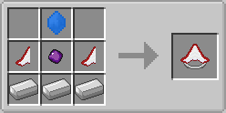
  <figcaption>Recette du Deltaplane</figcaption>
</figure>
<figure class="recette" markdown="span">
  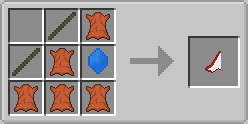
  <figcaption>Recette de l'Aile</figcaption>
</figure>

### Grappin

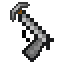{ .item-icon }
Il permet de s'accrocher à n'importe quel bloc et de s'élancer vers celui-ci, ce qui peut être utile pour certains déplacements.

Il ne peut être obtenu que dans les lucky-blocs et dans les caisses.

### Multi-Outil

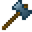{ .item-icon }
Cet outil est efficace sur n'importe quel type de bloc. Comme son nom l'indique, il combine plusieurs outils : la pioche, la pelle, la hache, ainsi que l'épée.

<figure class="recette" markdown="span">
  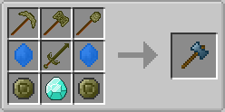
  <figcaption>Recette du Multi-Outil</figcaption>
</figure>

### Chercheur de Coffres

{ .item-icon }
Le chercheur de coffres affiche le nombre de blocs pouvant contenir des items dans une zone de 3x3 tronçons centrée sur le joueur. Il permet donc de trouver des bases cachées autour de vous, mais aussi des structures naturelles qui contiennent des coffres.

<figure class="recette" markdown="span">
  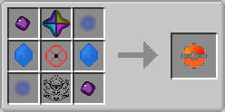
  <figcaption>Recette du Chercheur de Coffres</figcaption>
</figure>

### Cobble Void Stone

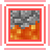{ .item-icon }
Cet item, lorsqu'il est dans votre inventaire, vous empêche de récupérer les items de pierre (cobble stone), de roche (stone) et leurs dérivés. Elle est très pratique en minage pour garder de la place dans votre inventaire pour les minerais.

<figure class="recette" markdown="span">
  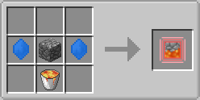
  <figcaption>Recette de la Cobble Void Stone</figcaption>
</figure>

### Clé de coffre

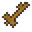{ .item-icon }
La clé de coffre vous permet de verrouiller un ou plusieurs conteneurs, de façon à ce qu'ils ne puissent être ouverts qu'avec une clé ayant le même code. Un conteneur verrouillé ne peut également pas être cassé directement, à moins de le déverrouiller, et ne peut pas être ouvert à moins d'avoir la clé adéquate en main.

Vous pouvez faire un clic sur la clé pour définir le code, et faire un sneak-clic sur un conteneur pour le verrouiller ou le déverrouiller.

<figure class="recette" markdown="span">
  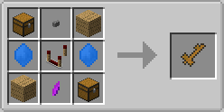
  <figcaption>Recette de la Clé de coffre</figcaption>
</figure>

### Annihilateur de Bedrock

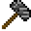{ .item-icon }
L'Annihilateur de Bedrock vous permet de… casser la Bedrock, hormis celle située sur la couche 0.

<figure class="recette" markdown="span">
  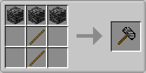
  <figcaption>Recette de l'Annihilateur de Bedrock</figcaption>
</figure>

## Armes spéciales

### Baguette laser

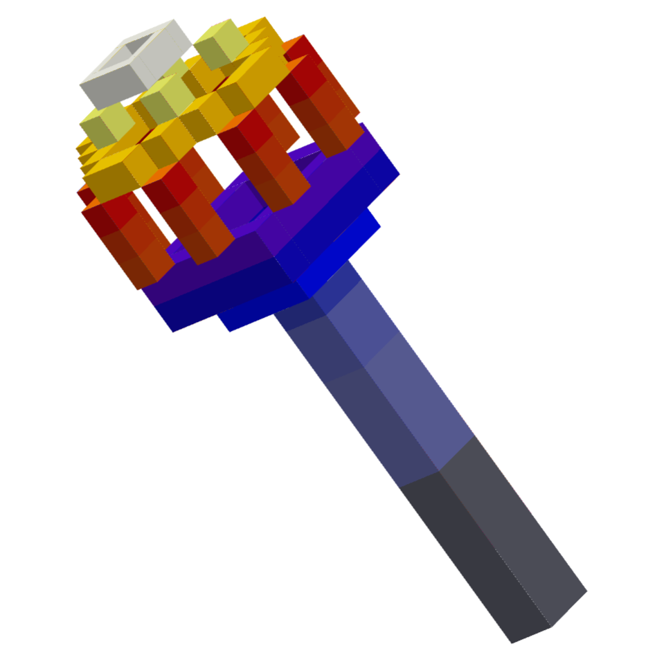{ .item-icon }
Elle permet de tirer un rayon laser qui enflammera et infligera 3 cœurs de dégâts à votre cible.

Elle ne peut être obtenue que dans les lucky-blocs et dans les caisses.

### Mjöllnir

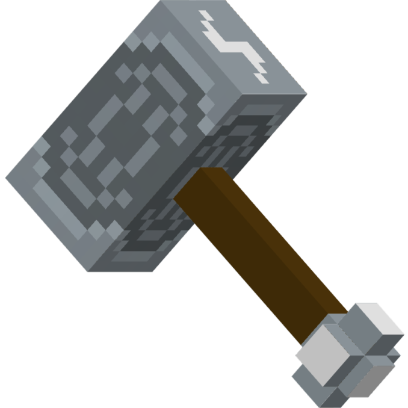{ .item-icon }
Le marteau de Thor, le Dieu de la foudre dans la mythologie nordique, permet en frappant votre ennemi de le foudroyer. Il vous protège également des dégâts de la foudre ainsi que de ceux du feu.

Il ne peut être obtenu que dans les lucky-blocs et dans les caisses.

## Nourritures

### Soupe Mystère

{ .item-icon }
Cette soupe donnera en la mangeant un petit effet de nausée pendant 5 secondes, ainsi qu'aléatoirement un ou plusieurs effets parmi les suivants, pendant 90 secondes :

- Rapidité (Speed) I
- Bonus de vie (Health boost) I ou II
- Fatigue de minage (Mining fatigue) II
- Faiblesse (Weakness) I

<figure class="recette" markdown="span">
  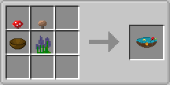
  <figcaption>Recette de la Soupe Mystère</figcaption>
</figure>

### Aventurie

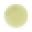{ .item-icon }
L'aventurie se consomme très rapidement, et donne un petit effet de rapidité une fois mangée, ce qui la rend très pratique pour régénérer pendant qu'un ennemi vous course.

<figure class="recette" markdown="span">
  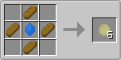
  <figcaption>Recette de l'Aventurie</figcaption>
</figure>
