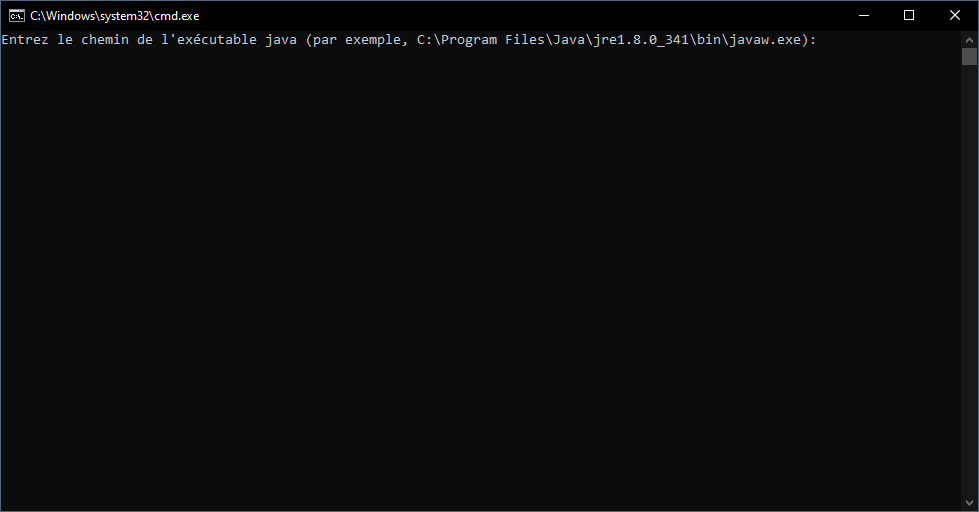
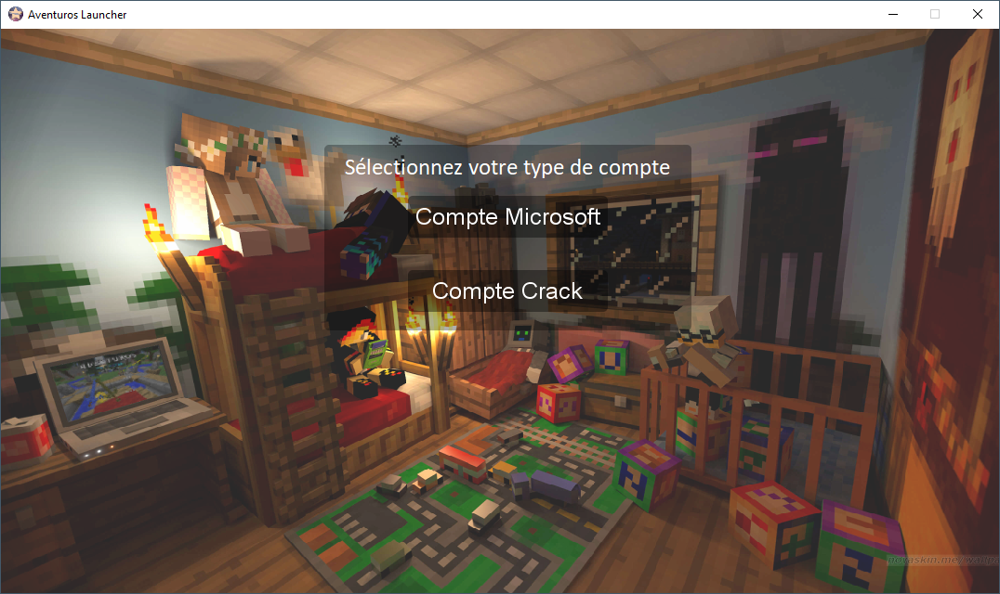
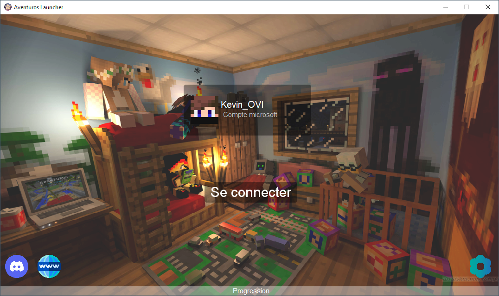
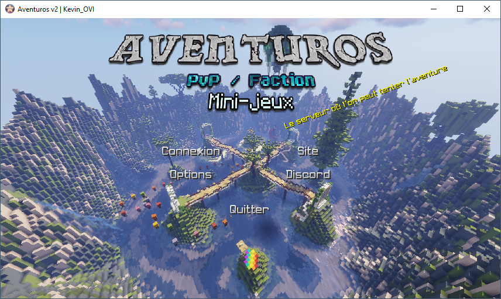

# Aide installation Launcher

## Installer Java

Le launcher et le jeu ont besoin de Java 8 pour fonctionner correctement. Vous pouvez le télécharger [ici](https://www.java.com/fr/download/) s'il n'est pas déjà installé sur votre ordinateur.

## Télécharger et exécuter le launcher

Téléchargez le launcher sur notre site. Vous pouvez aussi utiliser [ce lien direct](https://aventuros.fr/download/v2/Aventuros%20launcher.jar). Placez le fichier à un endroit accessible, par exemple sur votre bureau, ou dans votre dossier de jeux, si vous en avez un. C'est ce fichier que vous devrez lancer à chaque fois que vous souhaiterez jouer.

Vous pouvez maintenant double-cliquer sur le fichier. Patientez durant l'initialisation.

!!! note
    Le launcher peut redémarrer durant cette phase d'initialisation pour se mettre à jour.

??? question "Le launcher m'informe d'une incompatibilité avec la version de Java utilisée, pourtant j'ai bien installé Java 8. Que faire ?"
    Il se peut que vous ayez plusieurs versions installées sur votre machine. Nous vous recommandons dans ce cas :

    - soit de désinstaller les autres versions que Java 8, si vous ne les utilisez pas ;
    - soit de sélectionner l'exécutable Java que vous souhaitez utiliser.

    Nous avons cependant remarqué que Windows sélectionne toujours la dernière version de Java disponible, même en allant sélectionner manuellement l'exécutable. Nous avons donc développé [ce script](https://aventuros.fr/download/fix%20java%208.bat) qui automatise la modification directement dans le registre Windows. Le chemin de l'exécutable Java demandé est généralement situé à un de ces deux emplacements : `C:\Program Files\Java\jre-1.8\bin\javaw.exe` ou `C:\Program Files\Java\jre-1.8_version\bin\javaw.exe`. Vérifiez à ces emplacements sur votre ordinateur, et entrez le bon.

    <figure markdown="span">
      
      <figcaption>Script « fix java 8 »</figcaption>
    </figure>

## Connexion à votre compte

La première fois que vous lancerez le launcher, celui-ci vous demandera de vous connecter.

<figure markdown="span">
  
  <figcaption>Menu de connexion du launcher</figcaption>
</figure>

- Si vous avez un compte Minecraft premium, vous pouvez vous y connecter en sélectionnant « Compte Microsoft ».
- Si ce n'est pas le cas, vous pouvez vous connecter en « crack ». Le launcher vous demandera alors quel pseudo utiliser. Notez que pour des raisons de sécurité, vous ne pouvez pas utiliser de pseudo déjà utilisé par un compte premium. Vous devrez également taper un mot de passe à chaque connexion au serveur, de façon à n'autoriser personne d'autre à se connecter avec votre pseudo sur le serveur.

## Lancer le jeu

Une fois connecté à votre compte, le launcher affichera son écran principal. Vous pouvez à présent ajuster les paramètres du launcher avec le bouton en bas à droite, comme la mémoire allouée au jeu, le répertoire où les fichiers du jeu seront téléchargés, ainsi que certains mods supplémentaires. Le launcher affichera à quel compte vous êtes connecté. Vous pouvez le changer à tout moment en cliquant sur le bouton incorporé à cet affichage.

<figure markdown="span">
  
  <figcaption>Menu principal du launcher</figcaption>
</figure>

Lorsque vous êtes prêt, appuyez sur le bouton « Se connecter ». Le launcher téléchargera alors les fichiers nécessaires au jeu, ainsi que d'éventuelles mises à jour. Vous pouvez suivre l'évolution avec la barre de progression située en bas de la fenêtre. Lorsque cette opération est terminée, le jeu se lancera.

## Se connecter au serveur

Une fois le jeu lancé, vous pouvez ajuster les paramètres du jeu avec le menu des options. Enfin, cliquez sur le bouton « Se connecter » pour rejoindre le serveur.

<figure markdown="span">
  
  <figcaption>Menu principal du jeu</figcaption>
</figure>
