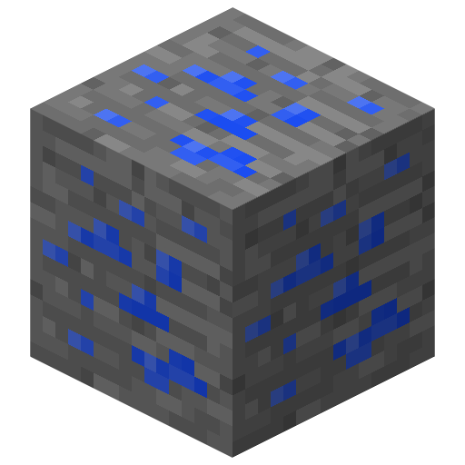
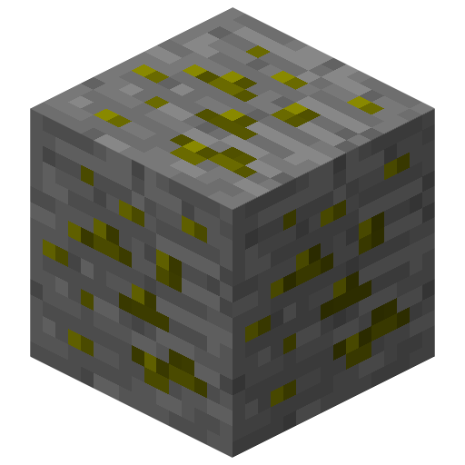
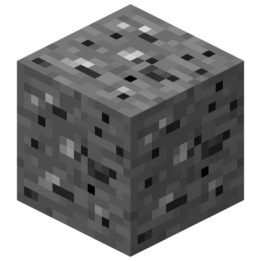
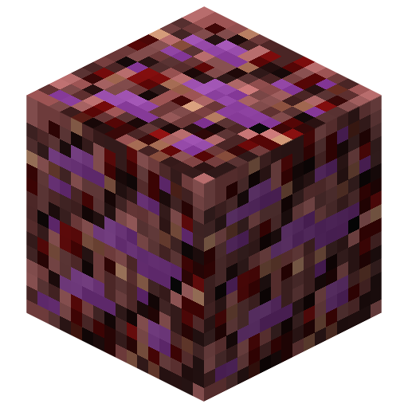

# Les Minerais

Quatre minerais moddés sont disponibles : l'**Electronium**, l'**Aventurium**, le **Bedrockium** et le **Galactium**. Ces minerais ne peuvent être trouvés qu'en monde minage, accessible depuis le lobby du serveur faction, ou avec la commande `/minage`.

## L'Electronium

{ .item-icon }
Il se génère dans l'**overworld**, entre les couches **1 et 12** (incluses). Il ne peut être miné qu'avec une pioche en Diamant ou un niveau supérieur.

## L'Aventurium

{ .item-icon }
Il se génère également dans l'**overworld**, des couches **1 à 8**. Vous devez disposer d'une pioche en Electronium ou un niveau supérieur pour le miner.

## Le Bedrockium

{ .item-icon }
Il se génère aussi dans l'**overworld**, entre les couches **1 et 5** (incluses). Vous devez disposer d'une pioche en Aventurium pour le miner.

## Le Galactium

{ .item-icon }
Il se génère pour sa part dans le **nether**, de **la couche 20 à la couche 108** (incluses). Vous devez disposer d'une pioche en Fer ou un niveau supérieur pour le miner.
